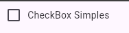
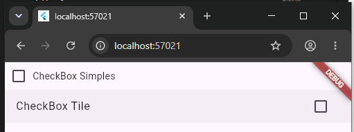

# CheckBox e Radio Buttons

Existem botões que você "marca e desmarca", este são o `CheckBox` e o `RadioButton`.

A diferença é que cada botão `CheckBox` é independente um do outro, quando você marca um não influencia no outro.
Use este botão quando o usuário pode marcar mais de uma opção de uma coleção de opções.
Por exemplo, quando você cria uma conta em uma rede social você pode marcar múltiplos interesses, como "carros", "filmes", "artes", dentre uma coleção de interesses.

Já no `RadioButton` você tem **grupos de botões** e somente um botão de cada grupo pode ser marcado. 
Use este botão quando o usuário pode marcar somente uma opção de uma coleção de opções excludentes.
Por exemplo, 
- se o usuário é maior ou menor de 18, 
- qual é o gênero do usuário.

## Como Criar um `CheckBox`

Um `CheckBox` simples pode ser criado pelo constructor `CheckBox(value: boolean, onChanged: void Function(bool?)?)`. 
O atributo `value` recebe um booleano e configura o valor inicial do `CheckBox`, e o atributo `onChanged` recebe uma função que recebe o valor que está marcado no `CheckBox` e é executada cada vez que este for clicado.

Diferente do `TextField`, não temos um controle para pegar o valor do `CheckBox`, precisamos ter uma variável e mudar o valor cada vez que este for clicado. Para isto, usamos a função do atributo `onChanged: (value) => variavel = value!,` (**obs** que é preciso incluir a função `setState` para atualizar em tempo real a mudança do `CheckBox`).

### Label do CheckBox

Este `CheckBox` simples não tem um espaço para o label, para ter uma estética de um `CheckBox` normal podemos colocar um texto ao seu lado usando o layout `Row`:

###### Exemplo
```dart
Row(children: [
    Checkbox(
        value: checkBoxSimplesValue, 
        onChanged: (value) => {setState(() {
            checkBoxSimplesValue = value!;
        })},
    ), 
    Text('CheckBox Simples'),
],), 
```

###### Resultado


### `CheckboxListTile`: Outro Tipo de CheckBox Com Label Incluído

Existe um outro tipo de `CheckBox` que inclui um label em seu contructor.
A vantagem de incluir um label é que o usuário **pode clicar no label** para mudar o valor do `CheckBox`.

Observe no exemplo abaixo uma página completa com o uso dos dois *checkboxes*.

```dart
import 'package:flutter/material.dart';

class CheckBoxExample extends StatefulWidget{
  @override
  State<CheckBoxExample> createState() => CheckBoxExampleState();

}

class CheckBoxExampleState extends State<CheckBoxExample>{
  bool checkBoxSimplesValue = false;
  bool checkBoxTileValue = false;
  @override
  Widget build(BuildContext context) {
    return Scaffold(
      body: Center(
        child: Column(
          children: [
            Row(children: [
              Checkbox(
                value: checkBoxSimplesValue, 
                onChanged: (value) => {setState(() {
                  checkBoxSimplesValue = value!;
                })},
              ), 
              Text('CheckBox Simples'),
            ],), 
            CheckboxListTile(
              value: checkBoxTileValue, 
              onChanged: (value) => setState(()=>checkBoxTileValue = value!),
              title: Text('CheckBox Tile'),
            )
          ],
        ),
      ),

    );
  }
}
```




## Radio Button

